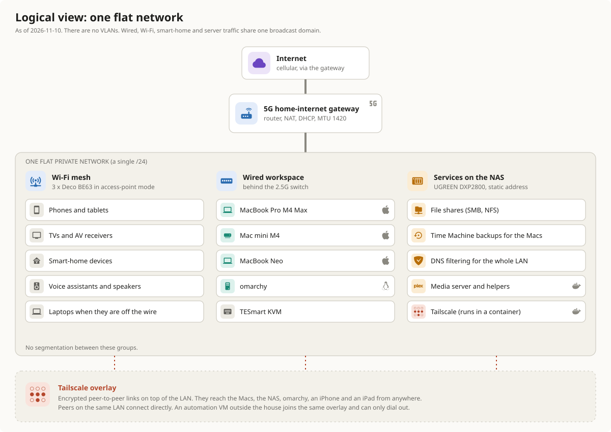

# Home network: logical diagram

<figure class="pro-diagram"><figcaption><em>The logical view, drawn on 2026-11-12: one flat network with three groups of devices and a Tailscale overlay.</em> Select the image to open it full size.</figcaption></figure>

## What the picture says

The network has one broadcast domain. The 5G gateway hands out addresses to everything, and the three groups in the picture are just my way of describing what the devices do. Nothing in the network enforces those groups.

- **Wi-Fi mesh.** Phones, tablets, TVs, AV receivers, smart-home devices and any laptop that is not on a cable.
- **Wired workspace.** The computers on the 2.5G switch, plus the KVM.
- **Services on the NAS.** File shares, backups, DNS filtering, the media server and its helpers, and the Tailscale container.
- **Tailscale overlay.** A second, encrypted network on top of the first. It does not replace the LAN. Peers on the same LAN talk to each other directly over it.

## How traffic moves

| Flow | Path | Notes |
|---|---|---|
| Internet | Device, mesh or switch, mesh root, gateway, 5G | Capped near 1 Gbit/s because the gateway's LAN ports are gigabit. The gateway's MTU is 1420. |
| DNS | Mac, NAS DNS filter, upstream | A small LaunchAgent on each Mac picks the server by where the Mac is: the NAS at home, the NAS over Tailscale when I am away, public resolvers if neither answers. |
| Files and backups | Mac, switch, NAS | SMB and NFS shares, plus Time Machine. |
| Remote access | Anywhere, Tailscale, the machine I want | Direct on the LAN, through a relay when I am away. |
| Keyboard and display sharing | Computer, KVM | Over USB and video. The network is not involved. |

## What is not here

I do not use VLANs, and I have not separated smart-home devices from computers. The switch is unmanaged, so VLANs would need different hardware, and I have not decided the split is worth it. If you are comparing this with a segmented design, the honest summary is one flat network with no trust zones. Anything remote goes through Tailscale. I have not audited the gateway's inbound rules for this page, so I make no claim about them.
