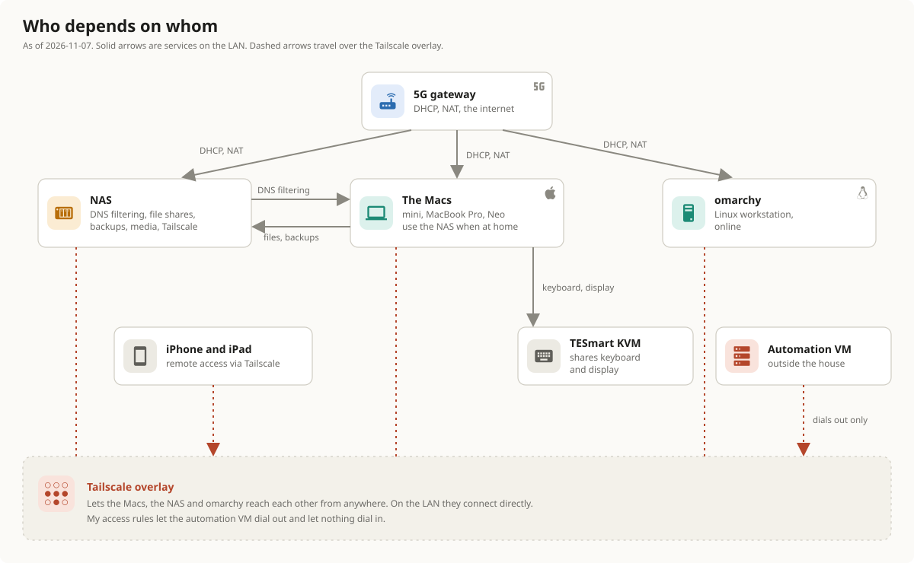

# Home network: relationships and failures

<figure class="pro-diagram"><figcaption><em>Who depends on whom, drawn on 2026-11-05. Solid arrows are services on the LAN; dashed arrows go over Tailscale.</em> Select the image to open it full size.</figcaption></figure>

## The dependencies in words

- **Everything depends on the gateway** for addresses and the internet, and on the mesh root node because the gateway plugs into it.
- **The Macs depend on the NAS** for files, Time Machine backups and, when at home, DNS.
- **The NAS depends on the switch** for its link to the wired computers and on the workspace node for its path to the gateway.
- **Remote access depends on Tailscale.** Direct links need nothing from the internet. Relayed links need it.
- **The KVM depends on nothing on the network** for its main job.

## What breaks when

"Observed" means it happened to me. "Expected" means I worked it out from the wiring and did not test it.

| If this fails | What stops | What keeps working | Status |
|---|---|---|---|
| The 5G gateway or the cellular signal | The internet for every device | Local traffic between machines that are already on the LAN | Expected |
| The mesh root node | The internet for everything, because the gateway plugs into it | Wired machines can still talk to each other through the switch | Expected |
| The workspace node | The switch loses its path to the gateway, so the wired machines lose the internet. Wi-Fi clients in range lose that node's coverage. | Machines on the switch still reach each other | Expected |
| The switch | The NAS and the wired computers lose each other and the network | Wi-Fi and the mesh | Observed on 2026-11-03, while it was misbehaving at install |
| The NAS | File shares, backups, media, the Tailscale container and the DNS filter | The internet. The Macs should fall through to public DNS resolvers. | Expected for DNS; not tested |
| A mesh wireless link | Wi-Fi at the far end gets slower or drops | Wired machines | Expected |

## Single points of failure

There are four: the gateway, the root node, the workspace node and the switch. Every wired machine depends on the last two in a chain. I have no second path, and the mesh nodes are not wired to each other. A wired run from the workspace node to the root node would replace the wireless hop, and the Deco keeps the wireless path as a fallback. I have not done it.
