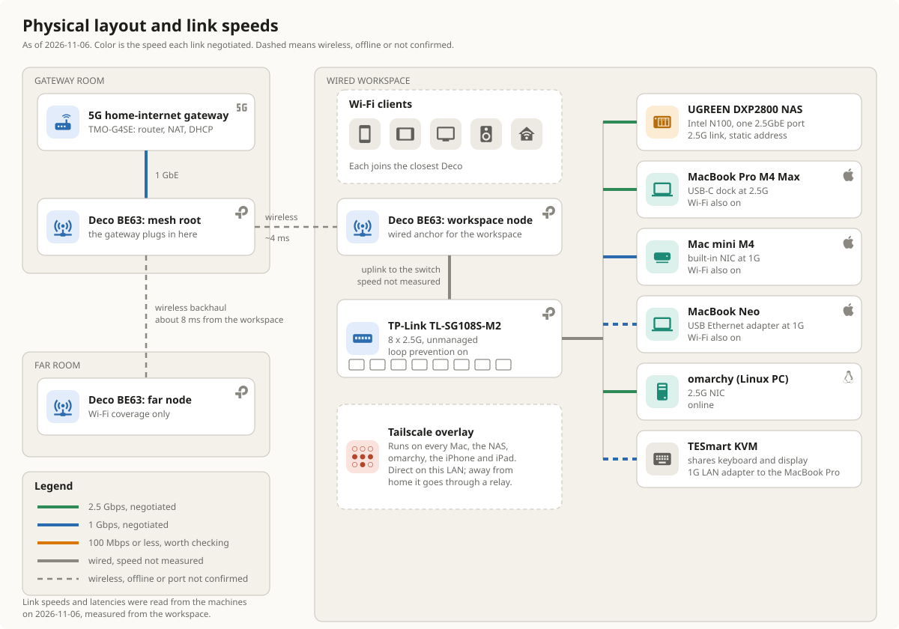

# Home network: physical diagram

<figure class="pro-diagram"><figcaption><em>The physical layout, drawn on {{as_of}}. Line color is the speed each link negotiated; dashed lines are wireless or a port I did not confirm.</em> Select the image to open it full size.</figcaption></figure>

## The links

| From | To | Medium | Speed | How I know |
|---|---|---|---|---|
| 5G gateway | Mesh root node | Ethernet | 1 GbE | Gateway LAN ports are gigabit; read 2026-11-01 |
| Mesh root | Workspace node | Wireless backhaul | Not measured | {{rtt_root}} from the workspace, measured {{as_of}} |
| Mesh root | Far node | Wireless backhaul | Not measured | {{rtt_far}} from the workspace, measured {{as_of}} |
| Workspace node | Switch | Ethernet, 2.5G-capable port | Not measured | Port speed not read |
| Switch | NAS | Ethernet | {{nas_speed}} | Read from the NAS itself on {{as_of}} |
| Switch | MacBook Pro (USB-C dock) | Ethernet | {{mbp_speed}} | Read from the Mac on {{as_of}} |
| Switch | Mac mini | Ethernet | {{mini_speed}} | Read from the Mac on {{as_of}}; its NIC is gigabit |
| MacBook Neo | Ethernet adapter | Ethernet | {{neo_speed}} | Read from the Mac on {{as_of}}; I did not confirm which port it uses |
| MacBook Pro | KVM's LAN adapter | Ethernet | {{kvm_speed}} | Read from the Mac on {{as_of}}; port not confirmed |
| Switch | omarchy | Ethernet | {{omarchy_speed_cell}} | {{omarchy_how_cell}} |

## What I measured, and what I did not

On 2026-11-03 I pulled 500 MB from the NAS to the MacBook Neo, twice, and got 107 to 110 MB/s. That is the ceiling of the Neo's gigabit adapter, not the NAS. It does tell me the NAS is no longer the bottleneck, and it does not show the 2.5G path running at full speed.

On 2026-11-01, before the switch, omarchy moved 600 MB to the NAS at 2.34 Gbit/s (94 percent of 2.5G) and the MacBook Pro managed 1.92 Gbit/s, limited by its USB 2.5G dock. I have not repeated that 2.5G test since the switch went in.

## Rooms

I describe the layout by role, not by room name. The workspace is the one room with every wired machine in it. The gateway is in a different room, one wireless hop away, and the far node is a second hop beyond that. That is why latency from the workspace is {{rtt_workspace}} to its own node, {{rtt_root}} to the root and {{rtt_far}} to the far node.
